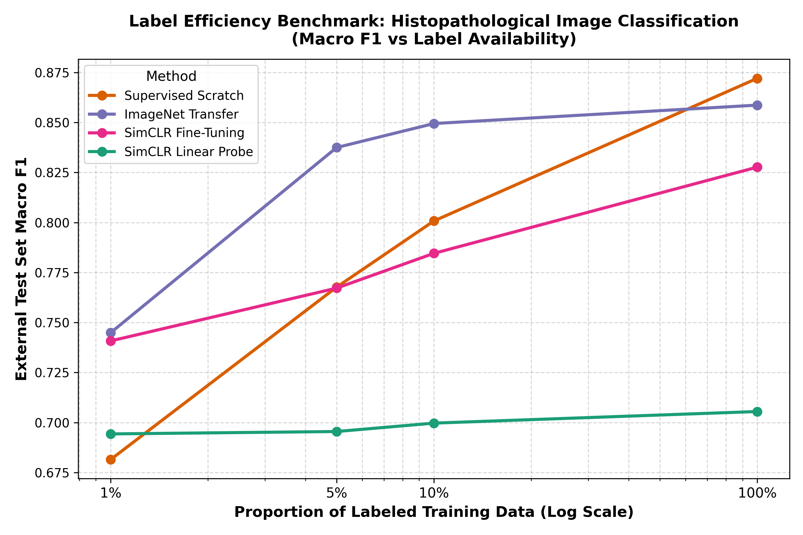
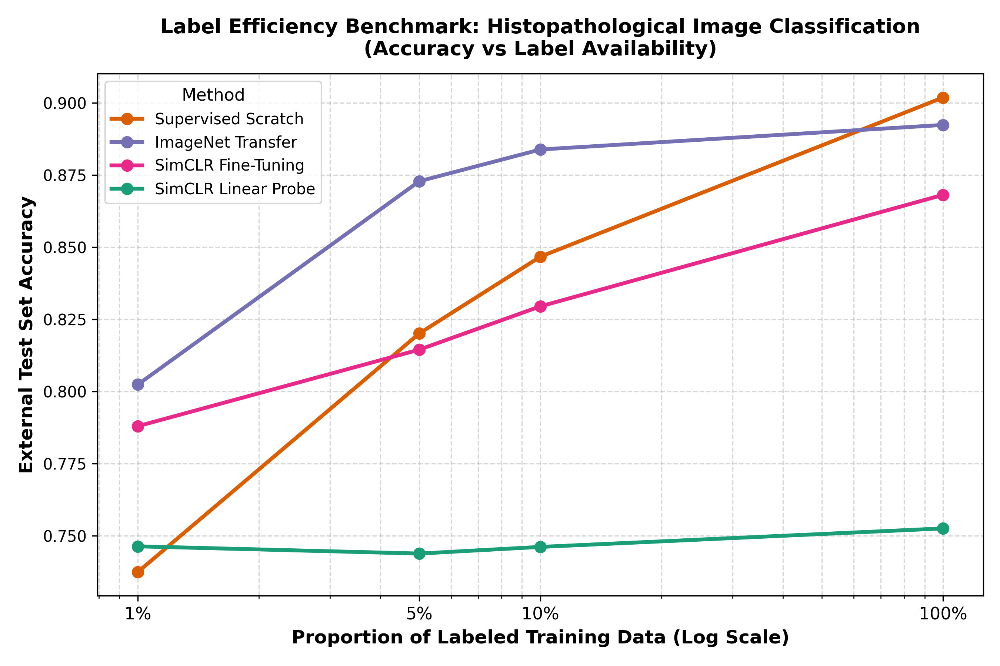
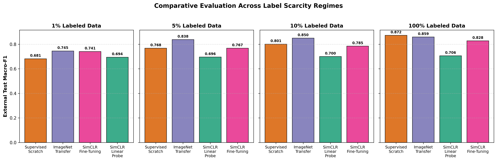
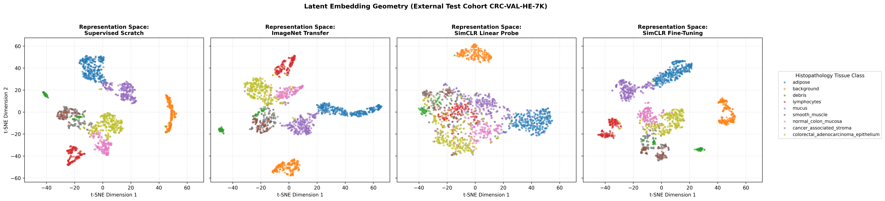

# Self-Supervised Representation Learning for Histopathological Image Classification Under Limited Label Availability

[](https://www.python.org/downloads/)
[](https://pytorch.org/)
[-green.svg)](https://medmnist.com/)
[](LICENSE)
[](results/reports/technical_project_report.md)
[-red.svg)](results/reports/technical_project_report.pdf)
[-success.svg)](results/reports/phase4_audit_report.md)

An empirical comparative study of self-supervised contrastive learning (**SimCLR**), **Supervised Learning from Scratch**, and **ImageNet Transfer Learning** for histopathological image classification across varying label availability regimes on the PathMNIST benchmark.

> **Scope & Experimental Setting Disclosure:**
> - **Single-Seed Pilot Benchmark:** All 16 experimental conditions were evaluated using a single controlled random seed (**Seed 42**). While providing identical sample indices across compared methods, these results serve as an empirical pilot benchmark and do **not** establish multi-seed statistical significance or cross-seed variance ($\mu \pm \sigma$).
> - **Standardized Image Resolution ($28 \times 28$ Pixels):** Experiments utilize the standardized $28 \times 28$ resolution provided by MedMNIST v2. The implications and morphological constraints of this resolution are documented below.
> - **Comparative Scientific Framing:** SimCLR is **not** claimed as the overall best method. ImageNet transfer learning leads across all low-to-medium label availability regimes (1%, 5%, 10%), while Supervised Learning from Scratch achieves the highest overall test accuracy and Macro F1 when 100% labels are available.
> - **Diagnostic Non-Readiness:** This repository is an academic machine learning research project and **not** a clinical diagnostic tool.

---

## Table of Contents
- [1. Research Motivation & Objectives](#1-research-motivation--objectives)
- [2. Key Empirical Findings](#2-key-empirical-findings)
- [3. Dataset, Resolution & Data-Split Isolation Checks](#3-dataset-resolution--data-split-isolation-checks)
  - [3.1 PathMNIST & External Test Cohort](#31-pathmnist--external-test-cohort)
  - [3.2 Implications of Standardized 28x28 Image Resolution](#32-implications-of-standardized-28x28-image-resolution)
  - [3.3 Tissue Class Taxonomy](#33-tissue-class-taxonomy)
  - [3.4 Data-Split Isolation Checks](#34-data-split-isolation-checks)
- [4. Methodology & Architecture](#4-methodology--architecture)
  - [4.1 SimCLR Contrastive Formulation](#41-simclr-contrastive-formulation)
  - [4.2 Domain-Specific Histopathology Augmentation Strategy](#42-domain-specific-histopathology-augmentation-strategy)
  - [4.3 Downstream Adaptation Paradigms](#43-downstream-adaptation-paradigms)
- [5. Master Experimental Results](#5-master-experimental-results)
  - [5.1 Comprehensive Benchmark Table](#51-comprehensive-benchmark-table)
  - [5.2 Label Efficiency Trajectories](#52-label-efficiency-trajectories)
  - [5.3 Exploratory Representation Geometry & t-SNE Projections](#53-exploratory-representation-geometry--t-sne-projections)
  - [5.4 Granular Per-Class Performance](#54-granular-per-class-performance)
- [6. Reproducibility & Audit Verification](#6-reproducibility--audit-verification)
- [7. Repository Structure](#7-repository-structure)
- [8. Installation & Quickstart](#8-installation--quickstart)
  - [8.1 Environment Setup](#81-environment-setup)
  - [8.2 Running Unit Tests](#82-running-unit-tests)
  - [8.3 Reproducing Pretraining & Benchmark](#83-reproducing-pretraining--benchmark)
  - [8.4 Interactive Jupyter Notebooks](#84-interactive-jupyter-notebooks)
- [9. Limitations & Clinical Reality](#9-limitations--clinical-reality)
- [10. Citation & Acknowledgements](#10-citation--acknowledgements)

---

## 1. Research Motivation & Objectives

In computational pathology, annotating whole-slide images (WSIs) requires subspecialized pathologists, rendering large-scale pixel- or patch-level ground-truth annotations labor-intensive and scarce. While deep neural networks perform well when given large volumes of labeled data, model performance often declines under limited label availability.

This project investigates the following primary research question:
> **Can self-supervised pretraining on unlabeled histopathological images produce better downstream representations and classification performance than conventional supervised learning and ImageNet transfer learning when only a small proportion of labeled data is available?**

### Core Controlled Investigations
1. **Label Efficiency at 1% Labels:** Examining downstream performance when only ~100 samples per tissue class are annotated ($N = 899$ samples total).
2. **Performance Dynamics Across Data Regimes:** Comparing relative model performance as labeled training data scales from 1% ($N=899$), 5% ($N=4,499$), 10% ($N=8,999$), to 100% ($N=89,996$).
3. **Linear Probing vs. Full Fine-Tuning:** Evaluating whether frozen feature representations ($h \in \mathbb{R}^{512}$) provide linear separability, or whether end-to-end backbone adaptation is required to separate morphologically adjacent tissue classes.
4. **Domain-Specific SSL vs. ImageNet Transfer Learning:** Comparing in-domain contrastive pretraining on unlabeled histological patches against supervised transfer learning from 1.28 million natural photographs.
5. **Class-Specific Performance Patterns:** Identifying which tissue categories (e.g., cancer-associated stroma vs. smooth muscle) present classification difficulties across paradigms.

---

## 2. Key Empirical Findings

All models were evaluated on the **untouched official external test cohort (CRC-VAL-HE-7K, $N = 7,180$)**. The following observations reflect the completed single-seed (**Seed 42**) pilot benchmark:

1. **Performance in the 1% Label Regime ($N = 899$):**
   - **Hierarchy at 1% Labels:** ImageNet Transfer achieved the highest Macro F1 (**0.7449**), followed by SimCLR Fine-Tuning (**0.7408**), SimCLR Linear Probe (**0.6943**), and Supervised Scratch (**0.6815**).
   - **SimCLR Fine-Tuning vs. Supervised Scratch:** SimCLR Full Fine-Tuning achieved **0.7408 Macro F1** and **78.80% Test Accuracy**, an observed difference of **+0.0593 Macro F1 (+5.05% Accuracy)** over Supervised Scratch in this run. Furthermore, SimCLR Fine-Tuning achieved the highest discriminative confidence across all models at 1% labels with a **Macro ROC-AUC of 0.9662** (compared to ImageNet Transfer's 0.9640 and Supervised Scratch's 0.9540).
   - **SimCLR Linear Probe (Frozen Backbone):** Achieves **0.6943 Macro F1** (Test Acc: 74.64%) compared to **0.6815 Macro F1** (Test Acc: 73.75%) for Supervised Scratch (+0.0128 Macro F1, +0.89% Accuracy) with lower training time (36.9s vs. 67.2s). Because only one seed was evaluated, this difference represents a single-seed pilot observation rather than a statistically confirmed advantage.

2. **ImageNet Transfer Learning Leads Across Limited Data Regimes (1%, 5%, 10% Labels):**
   - ImageNet Transfer achieved the highest Macro F1 across all limited-label conditions in this experiment: **0.7449 Macro F1** at 1% (followed by SimCLR fine-tuning at 0.7408), **0.8375 Macro F1** at 5%, and **0.8495 Macro F1** at 10%.
   - Pretraining on 1.28M natural images provides broad visual representations that transfer effectively to the low-resolution patch classification task.
   - **Scientific Clarification:** In-domain SimCLR was **not** the top-performing pretraining method in these limited-label regimes; ImageNet transfer learning consistently yielded higher test metrics.

3. **Supervised Scratch Performance at 100% Labels ($N = 89,996$):**
   - When trained on all 89,996 labeled training examples for 15 epochs (>21,000 gradient updates), **Supervised Scratch achieved the highest overall score of any method tested: 0.8721 Macro F1, 90.18% Test Accuracy, and 0.9916 ROC-AUC**, exceeding ImageNet Transfer (0.8587 F1) and SimCLR Fine-Tuning (0.8277 F1).
   - *Interpretation:* With abundant labeled data in this setting, training an unconstrained architecture from scratch directly optimizes all parameters for the target domain without residual inductive biases from pretraining objectives.

4. **Linear Probing Plateau vs. Fine-Tuning Scaling:**
   - Linear probing performance changed minimally across training subset sizes ($1\% \to 0.6943 \mid 100\% \to 0.7055$; $\Delta = +0.0112$), indicating that a single linear layer on frozen representations has limited capacity to leverage additional labeled data.
   - In contrast, full fine-tuning continued to improve as labeled sample size increased ($1\% \to 0.7408 \mid 100\% \to 0.8277$; $\Delta = +0.0869$).

5. **Observed Class Performance on Debris (Class 2):**
   - On Class 2 (**Debris**), SimCLR Linear Probe (0.5777 F1) and SimCLR Fine-Tuning (0.5505 F1) achieved higher observed F1 scores than Supervised Scratch (0.4355 F1) at 1% labels in this run. A possible hypothesis is that contrastive transformations help the encoder generalize across heterogeneous necrotic patterns, whereas supervised training on only ~100 samples per class may struggle with high intra-class variance.

---

## 3. Dataset, Resolution & Data-Split Isolation Checks

### 3.1 PathMNIST & External Test Cohort
This benchmark utilizes **PathMNIST from MedMNIST v2**, derived from the colorectal cancer histology cohort published by Kather et al. (*PLOS Medicine*, 2019):
- **Training Set (`train_images`, `train_labels`):** $N = 89,996$ non-overlapping patches ($28 \times 28 \times 3$, uint8), sourced from NCT-CRC-HE-100K.
- **Validation Set (`val_images`, `val_labels`):** $N = 10,004$ non-overlapping patches ($28 \times 28 \times 3$, uint8), sourced from NCT-CRC-HE-100K.
- **External Test Set (`test_images`, `test_labels`):** $N = 7,180$ non-overlapping patches ($28 \times 28 \times 3$, uint8), sourced from **CRC-VAL-HE-7K** (an independent patient cohort from the German DACHS study).

### 3.2 Implications of Standardized 28x28 Image Resolution
The experiments in this repository directly utilize the standardized $28 \times 28 \times 3$ pixel images provided by the official MedMNIST v2 distribution. While the original histological source images from Kather et al. were collected at higher resolution ($224 \times 224$ pixels at $0.5\,\mu\text{m/pixel}$), the downsampling to $28 \times 28$ was performed upstream by the MedMNIST benchmark creators, not by this project.

**Morphological Implications of this Resolution:**
- The low spatial dimension ($28 \times 28$) significantly constrains the availability of fine subcellular morphological features. Subcellular characteristics such as nuclear pleomorphism, chromatin margin irregularities, and mitotic figures cannot be reliably resolved at this scale.
- Consequently, models evaluated on $28 \times 28$ images necessarily rely on broader spatial patterns, including gross glandular architecture, local color and stain variations, cellular density, and overall texture.

### 3.3 Tissue Class Taxonomy
The 9 tissue categories map identically between PathMNIST and CRC-VAL-HE-7K:

| ID | Class Name | Abbr. | Histopathological Description | Clinical Context |
|:--:|:---|:---:|:---|:---|
| **0** | `adipose` | ADI | Mature adipocytes with peripheral nuclei and lipid vacuoles | Normal subserosal / submucosal fat |
| **1** | `background` | BACK | Optical slide void; absence of tissue and dye | Slide margin / clear space |
| **2** | `debris` | DEB | Amorphous necrotic debris, hemorrhage, staining artifact | Non-viable tissue fragments / artifact |
| **3** | `lymphocytes` | LYM | Dense aggregates of small, basophilic immune cells | Inflammatory infiltrate / immune response |
| **4** | `mucus` | MUC | Extracellular pools of basophilic/amorphous mucin | Mucin-producing epithelial secretion |
| **5** | `smooth_muscle` | MUS | Bundles of elongated eosinophilic spindle cells | Muscularis propria / vascular wall |
| **6** | `normal_colon_mucosa`| NORM| Organized crypts with goblet cells and enterocytes | Non-neoplastic colonic mucosa |
| **7** | `cancer_associated_stroma`| STR | Desmoplastic collagenous matrix and reactive myofibroblasts | Tumor-associated extracellular stroma |
| **8** | `colorectal_adenocarcinoma_epithelium`| TUM | Disorganized, cribriform malignant glands with hyperchromatic nuclei | Colorectal adenocarcinoma epithelium |

### 3.4 Data-Split Isolation Checks
To ensure strict data isolation and prevent contamination:
1. **Unlabeled Pretraining Isolation:** SimCLR pretraining accessed **exclusively** `data['train_images']` ($N = 89,996$). Validation and test images were never used during representation pretraining.
2. **Deterministic Stratified Subsets:** Downstream labeled subsets (1%, 5%, 10%, 100%) were sampled strictly from the training split using `StratifiedShuffleSplit` with fixed seeds, preserving relative class distributions.
3. **Cross-Method Parity:** For a given seed and proportion, all four paradigms received the **exact same sample indices**.
4. **Validation-Only Model Selection:** Early stopping and checkpoint selection monitored **only** validation macro-F1 (`val_loader`, $N = 10,004$).
5. **Test Set Quarantine:** The external test set (`test_loader`, $N = 7,180$) was quarantined and evaluated strictly once per completed model checkpoint. The test set was **never** used for model selection, hyperparameter tuning, or decision threshold optimization.

---

## 4. Methodology & Architecture

```
                    ┌────────────────────────┐
                    │ Input Image x in R^3   │
                    └───────────┬────────────┘
                                │
               ┌────────────────┴────────────────┐
               ▼                                 ▼
      View 1: t ~ T                      View 2: t' ~ T
  (Crop, Flip, Jitter, Blur)         (Crop, Flip, Jitter, Blur)
               │                                 │
               ▼                                 ▼
        ┌─────────────┐                   ┌─────────────┐
        │  ResNet-18  │                   │  ResNet-18  │
        │   Encoder   │                   │   Encoder   │
        └──────┬──────┘                   └──────┬──────┘
               │                                 │
         h_i in R^512                      h_j in R^512
               │                                 │
               ▼                                 ▼
        ┌─────────────┐                   ┌─────────────┐
        │ 2-Layer MLP │                   │ 2-Layer MLP │
        │  Head g(.)  │                   │  Head g(.)  │
        └──────┬──────┘                   └──────┬──────┘
               │                                 │
         z_i in R^128                      z_j in R^128
               │                                 │
               └────────► NT-Xent Loss ◄─────────┘
                         (tau = 0.1)
```

### 4.1 SimCLR Contrastive Formulation
SimCLR (*Chen et al., ICML 2020*) trains an encoder by maximizing agreement between differently augmented views of the same image:
- **Base Encoder $f(\cdot)$:** ResNet-18 producing representation $h = f(x) \in \mathbb{R}^{512}$.
- **Projection Head $g(\cdot)$:** 2-layer MLP mapping $h$ to projection $z = g(h) \in \mathbb{R}^{128}$ with intermediate dimension 512, Batch Normalization, and ReLU.
- **Pairwise Cosine Similarity:**
  $$s(u, v) = \frac{u^\top v}{\|u\|_2 \|v\|_2}$$
- **Normalized Temperature-Scaled Cross Entropy (NT-Xent) Loss:**
  For a batch of $N$ images producing $2N$ augmented views, the loss for positive pair $(i, j)$ is:
  $$\ell_{i, j} = -\log \frac{\exp\left(s(z_i, z_j) / \tau\right)}{\sum_{k=1}^{2N} \mathbb{I}_{[k \neq i]} \exp\left(s(z_i, z_k) / \tau\right)}$$
  The total batch objective is symmetric across all pairs:
  $$\mathcal{L}_{\text{NT-Xent}} = \frac{1}{2N} \sum_{k=1}^N \left[ \ell_{2k-1, 2k} + \ell_{2k, 2k-1} \right]$$
  A temperature parameter of $\tau = 0.1$ was used.

### 4.2 Domain-Specific Histopathology Augmentation Strategy
Standard SimCLR pipelines for natural images often apply aggressive colour distortions, including random conversion to grayscale. In this project, augmentations were adapted to accommodate histological image data:
- **Random Resized Crop:** Scale range $[0.6, 1.0]$.
- **Random Dihedral Flips:** Horizontal and vertical flips ($p = 0.5$).
- **Color Jitter:** Brightness ($\pm 0.3$), Contrast ($\pm 0.3$), Saturation ($\pm 0.3$), and tightly bounded Hue ($\pm 0.08$, $p = 0.8$). This provides an approximation of colour and intensity variations across patches while avoiding extreme hue inversions. It is an algorithmic approximation of color variability, not a validated model of inter-laboratory histological staining variation.
- **Gaussian Blur:** Kernel size $3 \times 3$, $\sigma \in [0.1, 2.0]$ ($p = 0.5$).
- **Grayscale Omission Rationale:** Random grayscale was omitted ($p = 0.0$) in the primary pipeline to avoid eliminating the characteristic pink (eosin) and purple (hematoxylin) color contrast present in H&E stained tissue.

### 4.3 Downstream Adaptation Paradigms
1. **Supervised Learning from Scratch:** Random weight initialization; all 11.2M parameters trained with Cross-Entropy loss ($\eta = 10^{-3}$, AdamW, Cosine Annealing to $10^{-6}$).
2. **ImageNet Transfer Learning:** Initialized from `torchvision` ImageNet-1k pretrained weights. Differential learning rates: $\eta_{\text{backbone}} = 10^{-4}$ to mitigate catastrophic forgetting, $\eta_{\text{head}} = 10^{-3}$ for classification head adaptation.
3. **SimCLR Linear Probing:** Backbone encoder weights $f(\cdot)$ are strictly frozen (`requires_grad = False`). Only a single linear layer $W \in \mathbb{R}^{9 \times 512}$ is trained ($\eta = 2 \times 10^{-3}$, AdamW). Directly evaluates the linear separability of the frozen representations.
4. **SimCLR Full Fine-Tuning:** Pretrained encoder initialized from `simclr_encoder_best.pth`. All layers adapted end-to-end with differential learning rates ($\eta_{\text{backbone}} = 10^{-4}, \eta_{\text{head}} = 10^{-3}$, AdamW).

---

## 5. Master Experimental Results

> **Methodological Note on Evaluation vs. Exploratory Analysis:**
> - **External Predictive Evaluation (Section 5.1):** Evaluated strictly on the complete external test set (CRC-VAL-HE-7K, $N = 7,180$). Model checkpoints were selected exclusively using validation split macro-F1 ($N = 10,004$). The test set was never accessed during pretraining, training, hyperparameter tuning, or threshold selection.
> - **Exploratory Latent Geometry & Clustering Analysis (Section 5.3):** Post-hoc exploratory analyses (2D t-SNE manifold projections, Silhouette Scores, Davies-Bouldin indices) were performed on penultimate representations ($h \in \mathbb{R}^{512}$) extracted from an exploratory subset of $N = 1,500$ test patches to inspect geometric clustering properties independently of classifier decision heads.

### 5.1 Comprehensive Benchmark Table
*Evaluated on official external test cohort CRC-VAL-HE-7K ($N = 7,180$). Checkpoint selection on validation split ($N = 10,004$). Seed 42 pilot benchmark.*

| Experimental Method | Labeled Data (%) | Labeled Samples | Test Accuracy | Balanced Accuracy | Macro Precision | Macro Recall | Macro F1-Score | Macro ROC-AUC | Wall Time (s) |
| :--- | :---: | :---: | :---: | :---: | :---: | :---: | :---: | :---: | :---: |
| **Supervised Scratch** | **1%** | 899 | 0.7375 | 0.6944 | 0.6978 | 0.6944 | **0.6815** | 0.9540 | 67.2s |
| **SimCLR Linear Probe** | **1%** | 899 | 0.7464 | 0.6995 | 0.6986 | 0.6995 | **0.6943** | 0.9526 | **36.9s** |
| **SimCLR Fine-Tuning** | **1%** | 899 | 0.7880 | 0.7484 | 0.7413 | 0.7484 | **0.7408** | **0.9662** | 52.2s |
| **ImageNet Transfer** | **1%** | 899 | **0.8024** | **0.7456** | **0.7477** | **0.7456** | **0.7449** | 0.9640 | 53.7s |
| | | | | | | | | | |
| **Supervised Scratch** | **5%** | 4,499 | 0.8201 | 0.7818 | 0.7783 | 0.7818 | **0.7677** | 0.9800 | 133.0s |
| **SimCLR Linear Probe** | **5%** | 4,499 | 0.7439 | 0.7053 | 0.6951 | 0.7053 | **0.6955** | 0.9544 | **57.6s** |
| **SimCLR Fine-Tuning** | **5%** | 4,499 | 0.8145 | 0.7745 | 0.7652 | 0.7745 | **0.7672** | 0.9745 | 132.8s |
| **ImageNet Transfer** | **5%** | 4,499 | **0.8728** | **0.8434** | **0.8349** | **0.8434** | **0.8375** | **0.9867** | 131.4s |
| | | | | | | | | | |
| **Supervised Scratch** | **10%** | 8,999 | 0.8467 | 0.8096 | 0.8047 | 0.8096 | **0.8008** | 0.9824 | 232.7s |
| **SimCLR Linear Probe** | **10%** | 8,999 | 0.7462 | 0.7100 | 0.6979 | 0.7100 | **0.6997** | 0.9555 | **83.0s** |
| **SimCLR Fine-Tuning** | **10%** | 8,999 | 0.8295 | 0.7914 | 0.7828 | 0.7914 | **0.7846** | 0.9771 | 235.1s |
| **ImageNet Transfer** | **10%** | 8,999 | **0.8838** | **0.8569** | **0.8483** | **0.8569** | **0.8495** | **0.9891** | 231.1s |
| | | | | | | | | | |
| **Supervised Scratch** | **100%** | 89,996 | **0.9018** | **0.8763** | **0.8708** | **0.8763** | **0.8721** | **0.9916** | 2185.6s |
| **SimCLR Linear Probe** | **100%** | 89,996 | 0.7526 | 0.7134 | 0.7045 | 0.7134 | **0.7055** | 0.9571 | **559.3s** |
| **SimCLR Fine-Tuning** | **100%** | 89,996 | 0.8681 | 0.8351 | 0.8263 | 0.8351 | **0.8277** | 0.9863 | 2038.7s |
| **ImageNet Transfer** | **100%** | 89,996 | 0.8923 | 0.8628 | 0.8582 | 0.8628 | **0.8587** | 0.9901 | 2023.5s |

### 5.2 Label Efficiency Trajectories

<p align="center">
  
  
</p>

<p align="center">
  
</p>

### 5.3 Exploratory Representation Geometry & t-SNE Projections
To explore representation geometry independently of classifier heads, penultimate feature embeddings ($h \in \mathbb{R}^{512}$) were extracted from an exploratory subset of $N = 1,500$ test patches of CRC-VAL-HE-7K:

<p align="center">
  
</p>

#### Quantitative Unsupervised Cluster Validity Metrics (Exploratory $N=1,500$ Test Subset)
*Note: A positive silhouette score indicates that sample embeddings are, on average, closer to their assigned class cluster than to neighboring clusters. It provides exploratory evidence of geometric grouping in latent space, but does not by itself prove semantic understanding or diagnostic readiness.*

| Representation Space | Silhouette Score ($\uparrow$, $[-1, 1]$) | Davies-Bouldin Index ($\downarrow$) | Representation Geometry Observation |
| :--- | :---: | :---: | :--- |
| **Supervised Scratch (10% Labels)** | **0.3197** | **1.4801** | **Highest silhouette score and lowest Davies-Bouldin index.** Supervised cross-entropy directly optimizes class separation on the available training classes. |
| **SimCLR Fine-Tuned (10% Labels)** | **0.1924** | **2.0727** | Fine-tuning the contrastive backbone yields higher silhouette separation than ImageNet transfer on this exploratory subset. |
| **ImageNet Transfer (10% Labels)** | **0.1415** | **2.1569** | Moderate geometric separation derived from general visual feature transfer. |
| **SimCLR SSL (Pretrained Only, No Labels)** | **0.1162** | **3.2115** | Displays a low but positive silhouette score prior to receiving labels, reflecting exploratory geometric separation without supervision. |

### 5.4 Granular Per-Class Performance
*Evaluated at 1% labeled data ($N = 899$, ~100 samples/class) on CRC-VAL-HE-7K:*

| ID | Class Name | Supervised Scratch | SimCLR Linear Probe | SimCLR Fine-Tune | ImageNet Transfer | Morphological Characteristics & Observations |
|:--:|:---|:---:|:---:|:---:|:---:|:---|
| 0 | Adipose | 0.9162 | **0.9547** | 0.9496 | 0.9538 | Distinct, empty lipid vacuoles with thin peripheral membranes; high performance across all models. |
| 1 | Background | 0.9260 | 0.9758 | 0.9674 | **0.9860** | Optically clear slide glass; highly separable from cellular tissue. |
| 2 | **Debris** | 0.4355 | **0.5777** | 0.5505 | 0.4566 | Amorphous necrotic fragments. SimCLR models showed higher F1 than scratch (+14.2%) in this single-seed run. |
| 3 | Lymphocytes | 0.8201 | 0.6904 | 0.8416 | **0.8869** | Round, basophilic immune cell nuclei; distinguishable stain intensity. |
| 4 | Mucus | 0.7456 | 0.6500 | 0.7501 | **0.8581** | Extracellular pale blue mucin pools; variable stain uptake. |
| 5 | Smooth Muscle | 0.5414 | 0.6056 | **0.6761** | 0.6452 | Elongated eosinophilic spindle fibers; partial confusion with reactive stroma. |
| 6 | Normal Mucosa | 0.6566 | 0.6889 | **0.7359** | 0.7013 | Regular crypt architecture with goblet cells; high structural regularity. |
| 7 | **Cancer-Assoc. Stroma** | 0.3707 | 0.3333 | 0.4116 | **0.4286** | **Lowest F1 across models.** Desmoplastic collagen bundles overlapping with tumor margin and muscle. |
| 8 | Adenocarcinoma | 0.7219 | 0.7727 | 0.7842 | **0.7878** | Malignant epithelial glands; intermediate performance across models. |

---

## 6. Reproducibility & Audit Verification

In compliance with rigorous research standards, an automated reproducibility audit was performed on all 16 saved checkpoints:
- **Audit Script Verification:** All 16 `.pth` checkpoints were independently re-evaluated over the external test loader. Recalculated Test Accuracy, Balanced Accuracy, Precision, Recall, Macro F1, and Macro ROC-AUC matched reported values to 4 decimal places with **zero discrepancies**.
- **Learning Rate Audit:** Verified that `min_lr = 1e-6` was consistently configured in `src/pretrain_simclr.py`, `src/train_supervised.py`, `src/finetune.py`, and verified in the optimizer state dict of `checkpoints/simclr_best.pth`.
- **Data Parity Audit:** Verified that `StratifiedShuffleSplit` with `seed=42` yields identical sample arrays across independent calls, ensuring true dataset parity across methods.

The full audit log and verification details are preserved in [`results/reports/phase4_audit_report.md`](results/reports/phase4_audit_report.md). The comprehensive engineering report is available in Markdown format at [`results/reports/technical_project_report.md`](results/reports/technical_project_report.md) and compiled as a standalone PDF at [`results/reports/technical_project_report.pdf`](results/reports/technical_project_report.pdf).

---

## 7. Repository Structure

```
medical-ssl-representation-learning/
├── LICENSE                                # MIT License
├── README.md                              # Master technical documentation
├── requirements.txt                       # Verified dependencies (PyTorch 2.6, torchvision, medmnist)
├── configs/
│   └── config.yaml                        # Hyperparameters (min_lr: 1e-6 explicitly noted)
├── data/
│   ├── README.md                          # PathMNIST / CRC-VAL-HE-7K lineage and split documentation
│   └── pathmnist.npz                      # Official MedMNIST v2 PathMNIST dataset
├── src/
│   ├── __init__.py                        # Package init
│   ├── augmentations.py                   # Histopathology SimCLR and supervised transforms
│   ├── datasets.py                        # Leak-proof data loaders and deterministic stratified subsetting
│   ├── evaluate.py                        # Test evaluation and penultimate feature extraction
│   ├── finetune.py                        # Linear probe and full fine-tuning training loops
│   ├── losses.py                          # Numerically stable NT-Xent contrastive loss
│   ├── metrics.py                         # Macro F1, balanced accuracy, ROC-AUC calculations
│   ├── models.py                          # ResNet-18, projection head, classifier architectures
│   ├── pretrain_simclr.py                 # SimCLR contrastive pretraining engine
│   ├── train_supervised.py                # Supervised scratch and ImageNet transfer loops
│   ├── utils.py                           # Hardware detection (MPS/CUDA), seeding, checkpointing
│   └── visualization.py                   # Publication-quality plots, confusion heatmaps, t-SNE
├── scripts/
│   ├── evaluate_models.py                 # Evaluates trained checkpoints directly on external test cohort
│   ├── generate_pdf_report.py             # Generates technical_project_report.pdf
│   ├── run_experiments.py                 # Master orchestration pipeline for all 16 conditions
│   └── summarize_results.py               # Generates Markdown and LaTeX result tables
├── notebooks/
│   ├── 01_dataset_exploration.ipynb       # EDA, split sizes, and class balance analysis
│   └── 02_embedding_visualization.ipynb   # t-SNE projections and silhouette cluster analysis
├── tests/
│   ├── test_environment.py                # Hardware, PyTorch, and MedMNIST environment tests
│   ├── test_losses.py                     # NT-Xent loss numerical stability and gradient tests
│   ├── test_phase2.py                     # Model architecture and data subsetting tests
│   └── test_phase3.py                     # SimCLR pipeline and scheduler smoke tests
├── checkpoints/                           # 20 preserved production weights
│   ├── simclr_encoder_best.pth            # Pretrained SimCLR ResNet-18 encoder weights
│   ├── simclr_encoder_final.pth           # Final SimCLR ResNet-18 encoder weights
│   ├── simclr_best.pth                    # Full SimCLR model (encoder + projection head)
│   ├── simclr_final.pth                   # Final SimCLR model
│   ├── supervised_scratch_prop*.pth       # Checkpoints for scratch baseline (1%, 5%, 10%, 100%)
│   ├── imagenet_transfer_prop*.pth        # Checkpoints for ImageNet transfer baseline (1%, 5%, 10%, 100%)
│   ├── simclr_linear_probe_prop*.pth      # Checkpoints for linear probing (1%, 5%, 10%, 100%)
│   └── simclr_fine-tuning_prop*.pth       # Checkpoints for full fine-tuning (1%, 5%, 10%, 100%)
└── results/
    ├── metrics/
    │   ├── results_summary.csv            # Master CSV containing all 16 exact numerical metrics
    │   ├── summary_table.md               # Markdown summary table
    │   ├── summary_table.tex              # Publication-ready LaTeX table
    │   └── metrics_*.json                 # 16 per-condition JSON metric records
    ├── plots/                             # 16 confusion heatmaps, 16 loss curves, t-SNE, comparison bar
    └── reports/
        ├── technical_project_report.md    # Master technical project report
        ├── technical_project_report.pdf   # Formatted 8-page technical project report PDF
        ├── phase4_completion_report.md    # Detailed empirical Phase 4 completion report
        └── phase4_audit_report.md         # Formal reproducibility and verification audit
```

---

## 8. Installation & Quickstart

### 8.1 Environment Setup
```bash
# 1. Clone repository
git clone https://github.com/your-username/medical-ssl-representation-learning.git
cd medical-ssl-representation-learning

# 2. Create virtual environment
python3 -m venv venv
source venv/bin/activate

# 3. Install dependencies
pip install --upgrade pip
pip install -r requirements.txt
```

### 8.2 Running Unit Tests
All unit tests run offline and verify loss stability, gradient flow, and data isolation:
```bash
python3 -m unittest discover -s tests
```
*Expected output: `Ran 22 tests in ~35s ... OK`.*

### 8.3 Evaluating Checkpoints & Reproducing Benchmarks
```bash
# Evaluate trained checkpoints directly on the untouched external test set (CRC-VAL-HE-7K, N=7,180):
PYTHONPATH=. python3 scripts/evaluate_models.py             # Evaluates 1% label regime models
PYTHONPATH=. python3 scripts/evaluate_models.py --all       # Evaluates all 16 benchmark checkpoints

# Run the complete experimental training pipeline (or retrain downstream models):
PYTHONPATH=. python3 scripts/run_experiments.py --skip-pretrain --downstream-epochs 15 --seeds 42 --proportions 0.01 0.05 0.10 1.00

# Regenerate consolidated Markdown and LaTeX summary tables:
PYTHONPATH=. python3 scripts/summarize_results.py

# Recompile the standalone technical project report PDF:
PYTHONPATH=. python3 scripts/generate_pdf_report.py
```

### 8.4 Interactive Jupyter Notebooks
Launch Jupyter to explore data distributions and interactive representation geometry:
```bash
jupyter notebook notebooks/
```
- [`01_dataset_exploration.ipynb`](notebooks/01_dataset_exploration.ipynb): Dataset inspection, patch visualizations, and empirical stain statistics.
- [`02_embedding_visualization.ipynb`](notebooks/02_embedding_visualization.ipynb): 2D t-SNE projections and quantitative silhouette score analysis.

---

## 9. Limitations & Clinical Reality

1. **Single-Seed Pilot Scope:**
   - All 16 experimental conditions were evaluated on a single controlled seed (**Seed 42**). While ensuring internal consistency across compared models, this benchmark does not measure cross-seed sampling variance ($\mu \pm \sigma$) or establish statistical significance testing (e.g., paired t-tests). Multi-seed sweeps across Seeds 123 and 456 are computationally intensive on edge hardware (~6.9 hours) and remain an area for future scaled evaluation.
2. **Resolution Constraints ($28 \times 28$):**
   - PathMNIST $28 \times 28$ patches capture gross tissue textures, staining intensity, and broad architecture, but lack high-resolution cytological details (mitotic figures, nuclear pleomorphism, nuclear-to-cytoplasmic ratio) necessary for clinical histopathological grading.
3. **Single Organ & Dataset Domain:**
   - This study focuses exclusively on colorectal histology patches from NCT-CRC-HE-100K and CRC-VAL-HE-7K. The empirical findings cannot be assumed to generalize directly to other anatomical sites (e.g., breast, prostate, lung), whole-slide slide-level aggregation (e.g., Multiple Instance Learning), or differing stain protocols without further cross-organ validation.
4. **Instance Discrimination vs. Semantic Pathology:**
   - Standard SimCLR treats all distinct patches as negative pairs, penalizing pairs of distinct patches that share the same biological tissue class. Supervised Contrastive Learning (SupCon) represents a natural future direction.
5. **Diagnostic Non-Readiness:**
   - This software is an academic research benchmark for representation learning. It is **not** a medical device, is not approved for clinical diagnostics, and must never be used for clinical decision-making.

---

## 10. Citation & Acknowledgements

If you find this research codebase useful in your work, please cite:

```bibtex
@article{medmnistv2,
    title={MedMNIST v2 - A large-scale lightweight benchmark for 2D and 3D biomedical image classification},
    author={Yang, Jiancheng and Shi, Rui and Wei, Donglai and Liu, Ziyun and Zhao, Lin and Ke, Bilian and Pfister, Hanspeter and Ni, Bingbing},
    journal={Scientific Data},
    volume={10},
    number={1},
    pages={41},
    year={2023},
    publisher={Nature Publishing Group}
}

@article{kather2019predicting,
    title={Predicting survival from colorectal cancer histology slides using deep learning: A retrospective multicenter study},
    author={Kather, Jakob Nikolas and Krisam, Johannes and Charoentong, Pornpimol and Luedde, Tom and Herwanto, Esther and Rei{\ss}felder, Christoph and Schneider, Franz and Meyret, Danielle and Haas, Michael and Zoernig, Ingo and others},
    journal={PLOS Medicine},
    volume={16},
    number={1},
    pages={e1002730},
    year={2019},
    publisher={Public Library of Science}
}
```

### License
This project is licensed under the MIT License - see the [LICENSE](LICENSE) file for details. PathMNIST data is distributed under the Creative Commons Attribution 4.0 International (CC BY 4.0) license.
